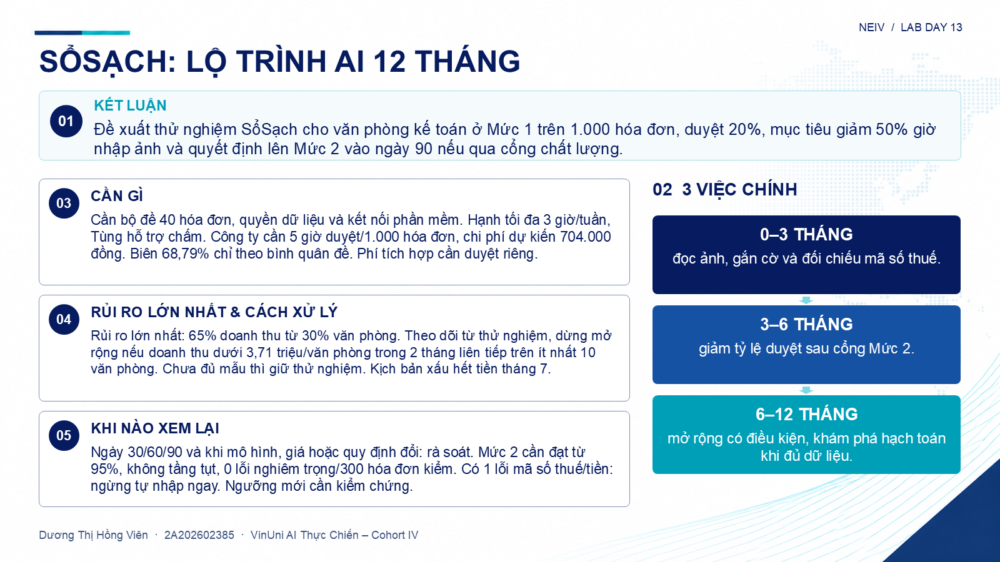

# Neiv · Lab Day 13 · Lộ trình sản phẩm AI

**VinUni AI Thực Chiến – Cohort IV**

- Học viên: Dương Thị Hồng Viên
- Mã sinh viên: 2A202602385
- Tên nhóm: Neiv
- Bài thực hành: Lab Day 13 (CS13), ngày 16/10/2026
- Đề lựa chọn: **Đề 1 · SổSạch**, theo quyền lựa chọn học viên giao.
- Danh sách thành viên: Dương Thị Hồng Viên.

## Sản phẩm

| File | Nội dung |
|---|---|
| [Neiv_CS13.xlsx](Neiv_CS13.xlsx) | Hoàn thành CP1–CP5, 6 việc có giả thuyết và điểm, 4 mức tự động, lộ trình 12 tháng, lịch rà soát, 5 thông điệp lãnh đạo |
| [Neiv_CS13_Slide.pptx](Neiv_CS13_Slide.pptx) | 1 slide cho lãnh đạo, nội dung khớp 5 ô trang 5 |
| [Thông tin và đóng góp](team/TEAM.md) | Họ tên, MSSV và bằng chứng đóng góp |
| [Báo cáo nhóm](report/team/group_report.md) | Căn cứ lựa chọn, kinh tế, điều kiện dừng và hạn chế |
| [Báo cáo cá nhân](report/team/2A202602385_DuongThiHongVien.md) | Phần việc, bằng chứng và nội dung tự đánh giá |
| [Phân tích AI](report/team/AI_REVIEW.md) | Nhận định rủi ro bị mô hình miễn phí làm thay và đối chiếu hồ sơ |

### Xem trước slide lãnh đạo

Slide gồm đúng 1 trang, dùng phong cách trắng–navy–cyan theo ảnh tham khảo. Nội dung lấy từ `5_Slide lãnh đạo!B4:B8`; phần lộ trình ở B5 được tách thành ba giai đoạn, giữ đủ nội dung. Chữ và sơ đồ chỉnh sửa được trong PowerPoint.

## Quyết định chính

Thử nghiệm SổSạch tại văn phòng kế toán với tối đa 1.000 hóa đơn, mục tiêu giảm 50% giờ nhập ảnh và duyệt khoảng 20%. Tận dụng bộ nhập tệp gốc và tích hợp đối chiếu mã số thuế trước khi tự nhập. Ngày 30 bàn giao quy trình và kết quả đo, ngày 90 quyết định lên Mức 2 nếu qua cổng. Gợi ý hạch toán chờ dữ liệu; không triển khai hỏi đáp thuế chung.

| Mức | Tỷ lệ duyệt dự kiến | Chi phí/việc | Biên gộp theo đề |
|---|---:|---:|---:|
| 0 · Gợi ý | 100% | 1.704 đồng | 24,46% |
| 1 · Hỗ trợ có duyệt | 20% | 704 đồng | 68,79% |
| 2 · Tự động một phần | 10% | 579 đồng | 74,33% |
| 3 · Tự động có giám sát | 5% | 516,5 đồng | 77,10% |

Mức 2 và 3 cần qua cổng trước khi triển khai. Duyệt mọi cờ và lấy mẫu không trùng; các tỷ lệ là giả định kế hoạch, phải tăng khi cờ tăng. Chi phí đã dùng 254 đồng gọi AI, 200 đồng hạ tầng/đánh giá/khác và 1,5 phút × 50.000 đồng/giờ cho mỗi hóa đơn được duyệt. Biên dùng 3.970.000 đồng/khách/tháng và 1.760 việc/khách/tháng. Phí dịch vụ phát sinh chưa có báo giá.

Có ít nhất 1 lỗi mã số thuế hoặc tiền thì dừng tự nhập ngay, lùi mức và điều tra. Nếu doanh thu bình quân dưới 3,71 triệu/văn phòng trong 2 tháng liên tiếp trên ít nhất 10 văn phòng thì dừng mở rộng. Văn phòng thử nghiệm phục vụ 40 doanh nghiệp không tương đương 40 văn phòng khách hàng; khi chưa đủ mẫu, giữ thử nghiệm và chưa kết luận vượt điều kiện kinh doanh.

Thử 1.000 hóa đơn cần khoảng 5 giờ duyệt và 704.000 đồng chi phí biến đổi ở Mức 1. Toàn bộ 12.000 hóa đơn/tháng của văn phòng thử nghiệm sẽ tốn 8,448 triệu đồng, nên không áp biên 68,79% của mức bình quân 1.760 việc cho quy mô này. Cần chốt giá/hạn mức hoặc ngân sách riêng trước khi mở rộng; phí phát sinh phải được duyệt.

## Kiểm tra và nguồn

Bản Excel được tính lại bằng Microsoft Excel: trang `6_Tự kiểm tra` đạt 8/8 mục, trang 5 có 5 ô dưới 60 chữ. Điều này xác nhận độ đầy đủ của biểu mẫu, không tự quy đổi thành điểm chấm. Giữ công thức, số liệu kinh tế và cấu trúc 9 trang gốc; chỉ điền đầu vào và điều chỉnh kích thước hiển thị cho nội dung.

[Bảng đối chiếu yêu cầu cuối](report/team/FINAL_REVIEW.md) dẫn đến bằng chứng CP1–CP5, rubric, yêu cầu cá nhân/nhóm và trạng thái nộp bài.

Tất cả số liệu là tình huống giả định trong `docs/CS13_HoSoTinhHuong.pdf`, Đề 1, trang 2–3. Ngưỡng bổ sung và điểm ưu tiên là đề xuất của bài lab, chưa phải kết quả chạy thực tế. Tham khảo `docs/CS13_SlideLop_AIRoadmap.pdf`, slide 74 và 81–85, cùng mẫu `src/CS13_Roadmap_De1.xlsx`. Không chép số kinh tế của bản mẫu sản phẩm khác. Nội dung có hỗ trợ AI, xem ghi nhận phân tích ở trên.

## Nộp bài

Link repo nộp trên VLearn: https://github.com/hviennduongne/K4-L3-CS13-Neiv-AI-Roadmap

Theo [hướng dẫn nộp](SUBMISSION.md): bản CP1–CP4 trước 18:00 ngày 16/10/2026, bản cuối có trang 5 và slide trước 23:59 ngày 19/10/2026, giờ Việt Nam. Không có bằng chứng đã nộp VLearn trong phiên làm việc này. Học viên cần kiểm tra quyền truy cập repo, dán link và gửi bài bằng tài khoản cá nhân.

Đề và hướng dẫn gốc vẫn nằm trong `docs/`, `src/`, [CHECKPOINTS.md](CHECKPOINTS.md), [RUBRIC.md](RUBRIC.md), [RULES.md](RULES.md). [README đề gốc](docs/HUONG_DAN_LAB_GOC.md) được lưu để đối chiếu.
